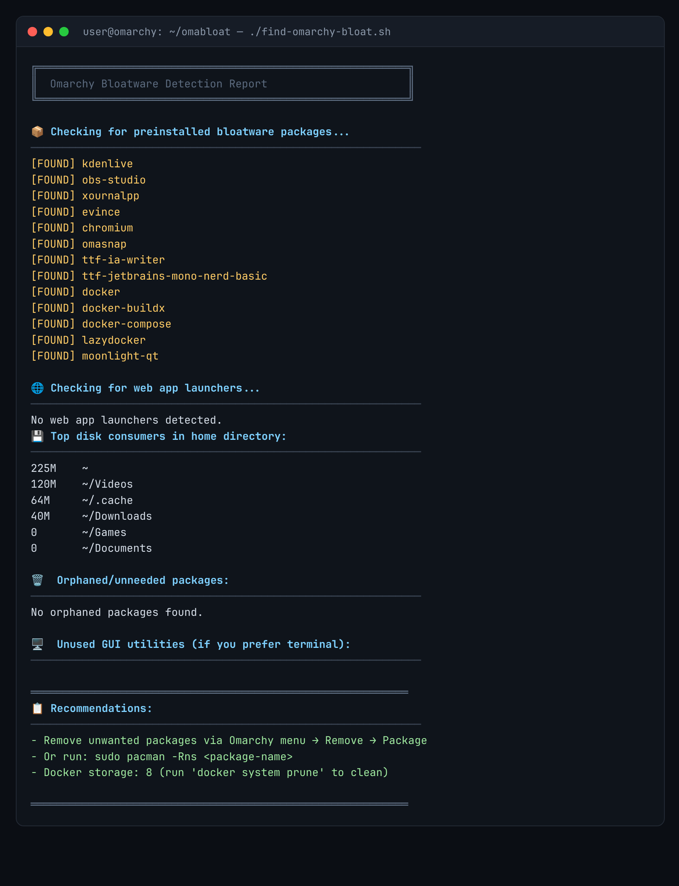

# omabloat

Find bloat on [Omarchy](https://omarchy.org/) — read-only — plus safe, opt-in
cleanup and Steam setup. Built for the average PC user: see what is installed,
decide what you actually use, and keep the machine feeling normal.

One repo, three jobs:

| Job | File | What it does |
| --- | --- | --- |
| Detect | [`find-omarchy-bloat.sh`](find-omarchy-bloat.sh) | Read-only report. Never changes anything. |
| Clean up | [`debloat-omarchy.sh`](debloat-omarchy.sh) | Guarded, confirmed removal. Audit by default. |
| Install Steam | [`install-steam.sh`](install-steam.sh) | Guided Steam setup with ProtonPlus guidance. |
| Extras | [`omarchy-essentials.sh`](omarchy-essentials.sh) | Useful-apps catalog; lists by default. |

The bar button is this repo itself: `manifest.json`, `BarWidget.qml`, and
`Panel.qml` live at the root, so installing the plugin installs the scripts too.

## What's new in v1.0.0

- **One repo.** The old `omababy` repo is now part of `omabloat`.
  `github.com/TopGoy333/omababy` and `github.com/TopGoy333/omablota` both
  redirect here.
- **Bar button.** `omarchy plugin add https://github.com/TopGoy333/omabloat --enable`
  puts a broom icon in the bar that opens the tools.
- **Fixed install.** The old manifest claimed a plugin kind this Omarchy
  version does not support, so the plugin never actually installed. It is now
  a real `bar-widget` at the repo root, validated with `omarchy plugin validate`.
- **Cleaner logs.** Debloat plans are written to `~/.local/share/omabloat/`.

## Quick start

```bash
chmod +x find-omarchy-bloat.sh debloat-omarchy.sh install-steam.sh omarchy-essentials.sh
./find-omarchy-bloat.sh              # read-only baseline
./debloat-omarchy.sh                 # read-only audit
./debloat-omarchy.sh --audit         # same thing, explicit
./install-steam.sh --check           # read-only Steam status
```

Nothing removes anything by default. The detector is the safe first-and-last
step: run it before you add apps, and again after you finish.

## Bar button

```bash
omarchy plugin add https://github.com/TopGoy333/omabloat --enable
```

That installs `topgoy333.omabloat` (this repo). Click the broom icon in the
bar to open the panel:

- **omababy** — the two original tools: *Find bloat* (read-only scan) and
  *Install Steam* (guided, asks first).
- **More tools** — disk space report, debloat audit, and the essentials catalog.

Each row opens your terminal and runs that script. The terminal stays open so
you can read the output.

Move it if you like:

```bash
omarchy bar move topgoy333.omabloat --section right
```

## What the scan reports

1. Preinstalled packages that are common bloat candidates (office suites,
   media editors, Chromium web-app wrappers, optional services like Docker).
2. Web-app launchers in `~/.local/share/applications` (Discord, YouTube, …).
3. The biggest folders in your home directory.
4. Orphaned packages (`pacman -Qdtq`).
5. Graphical utilities you may not need in the terminal.
6. With `--space-only`: disk used by each candidate.
7. Suggestions only — never executed.

## Safety

- `find-omarchy-bloat.sh` is read-only: no `pacman -R`, no `rm`, no services.
- Cleanup tools ask before they change anything and never run freely.
- The debloat guard list protects Dolphin, Bazaar, Omarchy itself, and the
  `claude-*` wrappers.

## See it working



Full example output: [`assets/example-output.txt`](assets/example-output.txt).

## More

- [`purpose.md`](purpose.md) — why this repo exists
- [`SECURITY.md`](SECURITY.md) — reporting a vulnerability
- [`index.html`](index.html) — browser-readable overview
- [`uninstall.md`](uninstall.md) — remove the bar plugin

## History

This repo absorbed the old `omababy` repo. `omababy` now redirects here.
